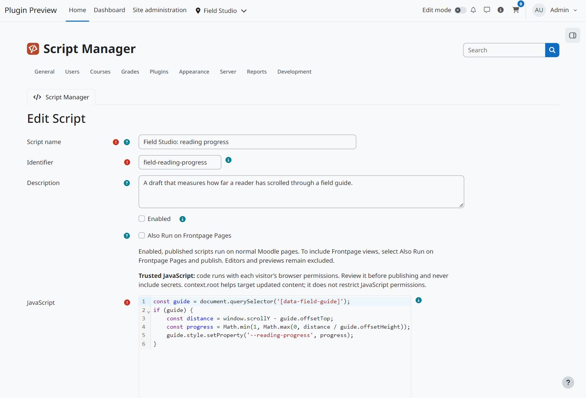
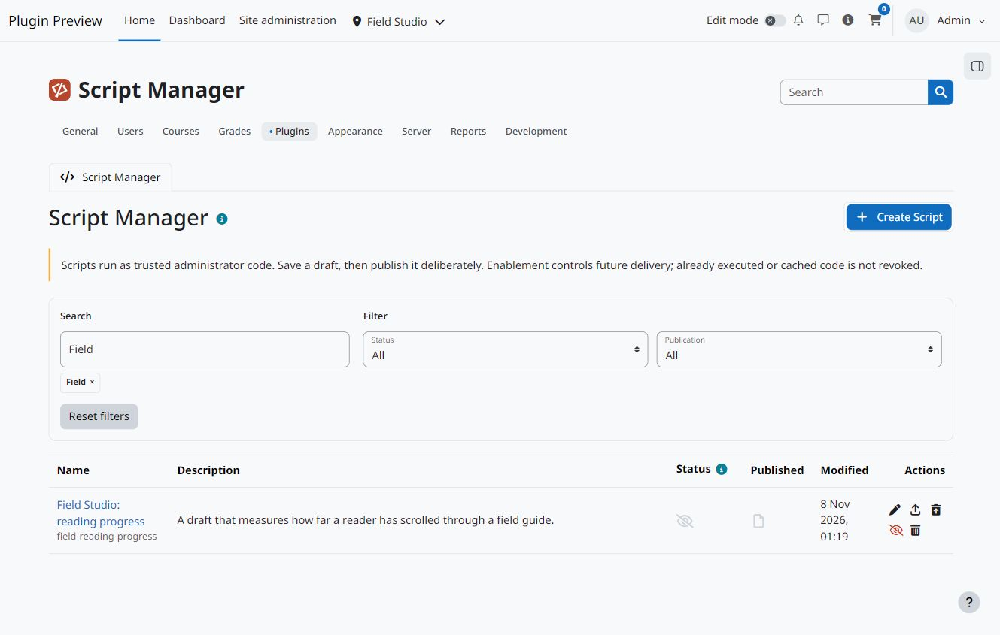

  

# Script Manager LE

Manage JavaScript snippets for trusted Moodle administrators.

## Screenshots

View screenshots

## Installation

Supports Moodle 4.5 through 5.3. Download the [signed beta ZIP](https://github.com/108design/moodle-local_scriptmanager-le/releases) and install it as `local/scriptmanager`.

Save drafts, publish immutable versions, compare revisions and restore an earlier version into the editor. Restoring requires a deliberate publication before the restored code becomes live. Enable or disable each script separately. New snippets start disabled and unpublished.

Enabled, published scripts run at the footer hook on normal Moodle pages. To include the Frontpage home for guests and members and normal Frontpage Course Activity views, select **Also Run on Frontpage Pages** and publish the script. This option starts off. Frontpage editors and previews, administration, login, authentication, tools, Script Manager, installation and special layouts stay excluded. If a script breaks another page, you can still sign in and disable it.

The independent CodeMirror editor provides JavaScript editing. The runtime supplies context.root, pageType, pageId, courseId and categoryId, and reinitialises snippets on Moodle content updates. Use repeatable initialisers. Selection follows script names alphabetically and does not wait for asynchronous work.

Scripts run with each visitor’s browser permissions and can access the page and network. Keep secrets out of browser code. Synchronous errors are logged; this does not isolate loops, asynchronous failures or changes already made. Disabling a script affects future delivery and cannot revoke code already executed or cached.

Concurrent editors use the last saved draft; there is no optimistic draft conflict check.

See [LICENSE.md](LICENSE.md) for the 108design Software License, its Moodle Marketplace permission and third-party CodeMirror notices.
